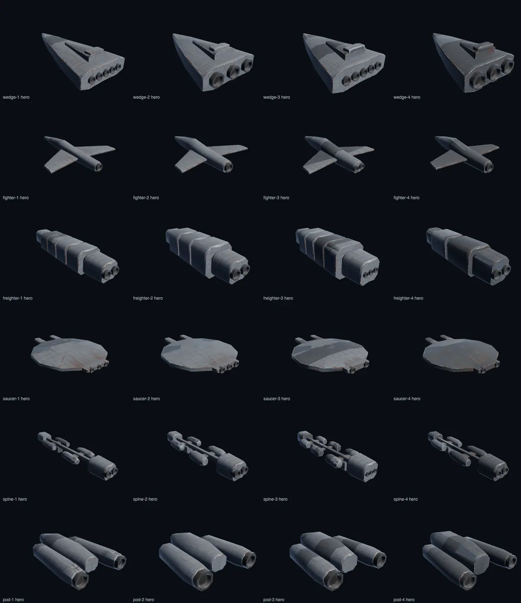
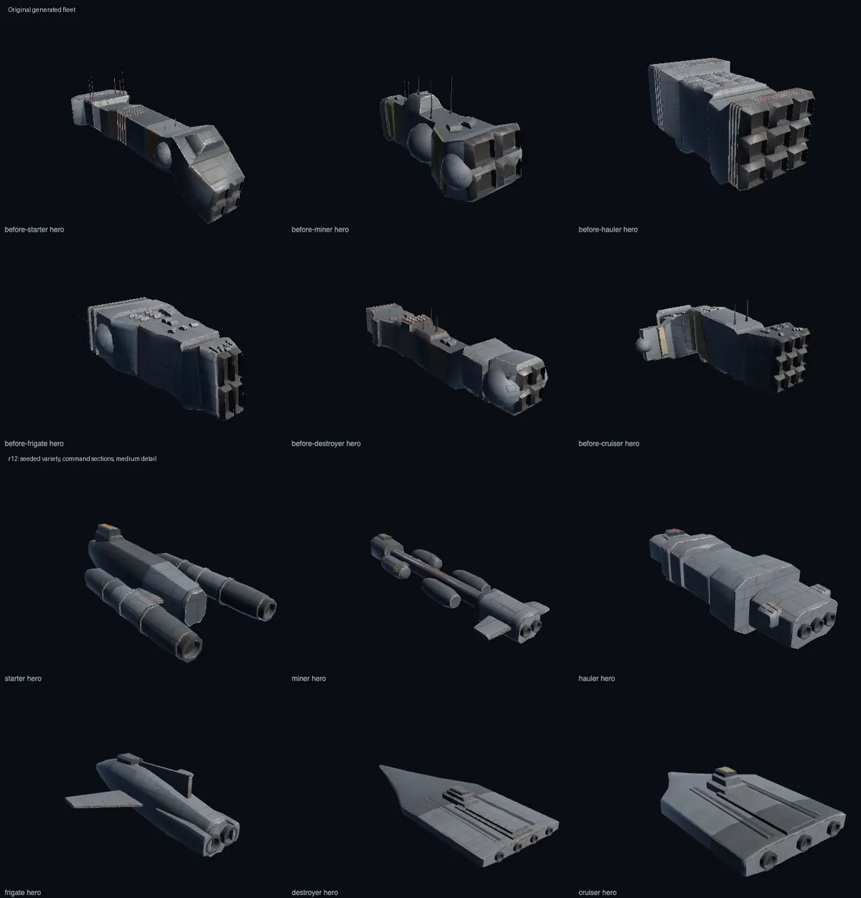
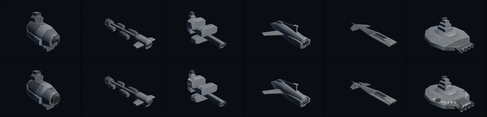
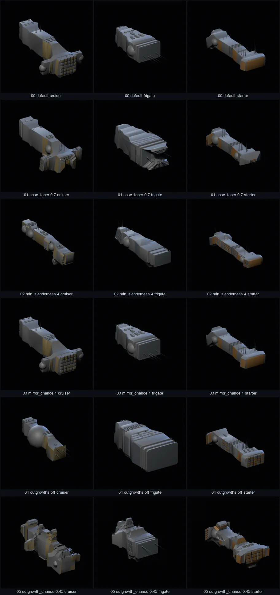
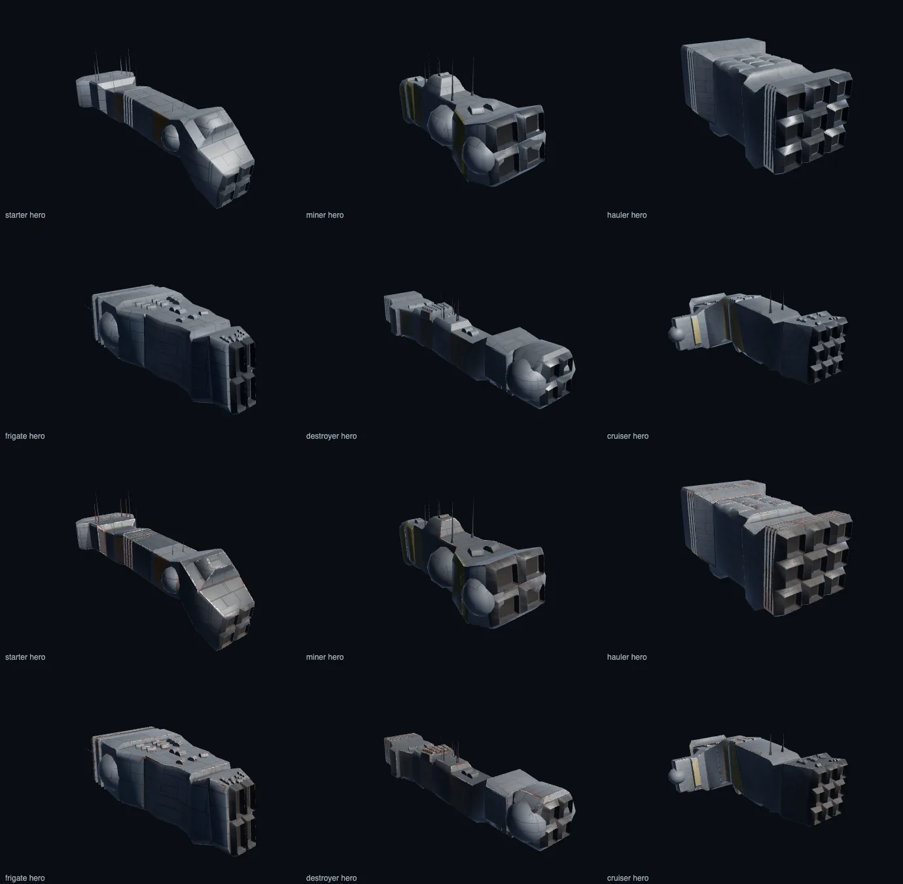
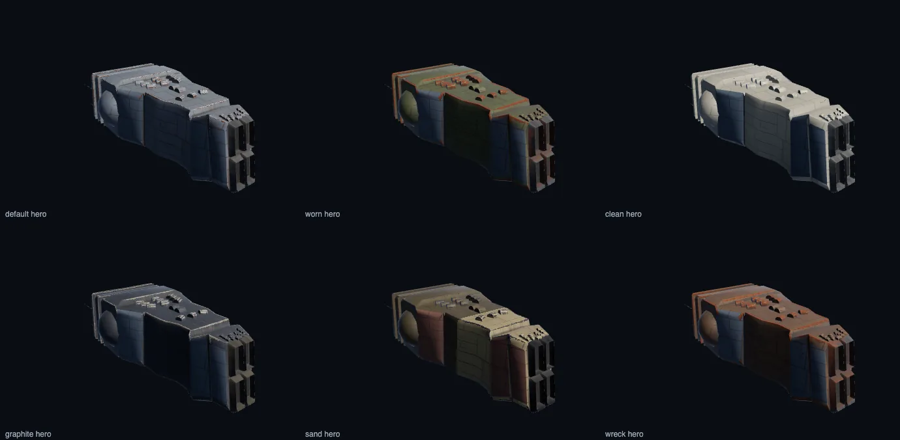

# Spaceship Generator

A Blender script to procedurally generate 3D spaceships from a random seed.

What this fork adds
-------------------
This is a fork of [Michael Davies's Spaceship Generator](https://github.com/a1studmuffin/SpaceshipGenerator), under the same MIT licence. It is maintained for Galaxy, a browser space game whose hulls it generates. The screenshot above is the original's.

In the generator itself:

* **Blender 4.2 to 5.x.** The API the original was written against is gone from current Blender; this runs on it as it is, add-on included.
* **Bug fixes.** Equal minimum and maximum segment counts no longer raise; `assign_materials=False` no longer builds and loads the textured materials anyway; a darkened material colour keeps its alpha. Grid dressing no longer extrudes adjacent hull faces over engine throats.
* **Parameters for what was hard-coded** in `generate_spaceship()`: the hull's proportions, the length of a segment, how often an end face tapers, steps, tilts or is ribbed, how often a face grows an outgrowth, each kind of detail on or off, how deep a grid is cut, how thickly antennas stand, how many sides a round part has, how often the ship is mirrored. The comment above the function lists them all.
* **Six silhouette-first archetypes:** `wedge` (the default), `fighter`, `freighter`, `saucer`, `spine`, `pod`. Each now has `balanced`, `compact`, `split` and `stacked` layouts: single bodies, twin booms or lenses, different wing configurations and vertical cargo/command stacks. Seeds vary their proportions, modules, wings and engine banks. Explicit canopies and command sections, stepped bridges, plating rails, ribs and intakes sit between the main silhouette and sparse fine grids. Curved faces use angle-based smoothing. `wing_span`, `fuselage_roundness` and `taper` tune the forms. Every new archetype is bilaterally symmetric; vertical mirroring is optional.
* **Opaque cockpit glass**, a separate face-zone/material slot with a dark tint and low roughness, never emission. Existing material indices 0–4 remain unchanged; glass is slot 5.
* **The original extrusion route is `classic`**, with `nose_taper` and `min_slenderness` controls.
* **Every ship with detail has an engine.** The original could leave one out: when no stern face was square enough to carry it, or when the only one stood on the half the mirror discarded.
* The movie renderer and other unused code are gone.
* Defaults intentionally changed: a seed now draws a symmetric wedge, not the old box chain. Select `archetype="classic"` for the original machinery; its horizontal mirror chance now defaults to 1.
* Archetypes keep their engines even with surface detail disabled.
* **Hardware, not greebles.** `pipes` runs tubes nose to stern along a plate, `armour` stands plates proud of the plating, `intakes` sinks barred recesses into a flank, `hubs` bolts refuelling couplings, `mounts` lays flat bare-metal pads for equipment that is not there yet, `ladders` puts rails and rungs down a side, and `lattice` hangs a tool frame off the belly. Each is a 0–1 density: the count and the place are drawn from the seed, and 0 draws nothing. Every fitting is laid on the half the horizontal mirror keeps, so the symmetrize that follows gives it its pair, and it is skipped on panels too thin to carry it — a tube on a wing's edge reads as a strut.
* **Six nozzle shapes** instead of the one bell: `round`, `square`, `slot`, `cluster` (three small ones), `bell` (flared) and `grille` (recessed, with bars across its mouth). Whichever it is, the throat's floor keeps the exhaust material, so a reader of the mesh — Galaxy's plume anchors — still finds the drive.
* **A lamp slot for large hulls.** Zone 6 is a lamp: flat warm panes standing just off the plating, in rows for quarter windows, and the lit ceiling of a docking bay whose mouth is a recess in a flank. It is the only face a hull emits from; the caller decides whether a hull carries any at all.

### Silhouettes first

Rows: wedge, fighter, freighter, saucer, spine, pod. Columns: four consecutive seeds, `galaxy-1` through `galaxy-4`. Galaxy's wrapper has randomisation on: unset controls, including the layout, are drawn deterministically from archetype-specific ranges; paint and weather are held fixed here to make shape differences readable. These are the generator's meshes in **Galaxy's real-time layered shader**, not the add-on's material. The inspiration is silhouette hierarchy — arrowheads, paired nacelles, discs — not copied franchise models.

Rows 1–2: before and after at equal length. Rows 3–4: before and after on the same camera at game scale (25, 30, 40, 35, 60 and 90 metres). Starter is a compact pod; miner a spine; hauler a stacked freighter; frigate a fighter; destroyer a narrow dagger wedge; cruiser a broad stacked saucer with a tall bridge and four drives. Both use Galaxy's layered material. The new hero/fleet pairs total 524 kB, versus 653 kB before this pass; all stay below 4,000/1,200 triangles, one draw call per hull.

### Hardware, drives and lamps

Above: the six shipped hulls as they were. Below: the same hulls after the hardware pass, at the same camera and in Galaxy's real-time material. The hauler gains rows of quarter lights along its containers and a lit docking bay; the cruiser a ring of them round its deck; every class gains tubes, armour plates, pads, couplings and ladders drawn from its own seed. The nine new controls are densities, so a sweep from 0 to 1 is a sweep from a bare hull to a busy one. The new hero/fleet pairs total 946 kB against 524 kB, still one material and one draw call a hull, and all inside the 4,000/1,200 triangle ceilings; frame time on a hull filling a phone's frame moves by 0.03–0.06 ms.

### What the parameters do

Historical `classic` parameter sweep: three seeds, one per column; original defaults, `nose_taper=0.7`, `min_slenderness=4`, `horizontal_symmetry_chance=1`, `create_asymmetry_segments=False`, `asymmetry_chance=0.45`. The fourth row matches the first because these three seeds were already mirrored. The labels are Galaxy's parameter and class names. These are Blender renders in Galaxy's flat paint, not the add-on's materials.

The randomisation policy lives in Galaxy's `genhull-params.json` and `genhull.py`, not this add-on. An explicit control always wins, including a value equal to its ordinary default. Galaxy writes the complete drawn recipe into `entry.json.params`, so its workshop can reproduce it with the same seed.

### In Galaxy

The layered pictures are not what this add-on renders. They are the generator's meshes drawn in Galaxy's real-time shader (three.js, WebGL2); paint, chips, rust, dirt and the glass's Fresnel sky reflection belong to that shader. It reads masks Galaxy bakes onto the mesh — sharp-edge distances, shelter and face zones. **`art/blender/skin.py` lives in Galaxy, not this repository.** This fork supplies the shape and face-zone indices; Galaxy draws them as one opaque material without emissive windows.

Six hulls from this fork, in Galaxy. Above, its earlier flat paint; below, its layered paint on the same meshes.

One generated hull, six finishes, all from Galaxy's shader: the mesh is the same in each.

Usage
-----
* Install Blender 4.2 or greater: http://blender.org/download/
* Run `python build.py` in this folder to make `add_mesh_SpaceshipGenerator.zip`
* Under Edit > Preferences... > Add-ons > Install... open the downloaded ZIP file
* Under Edit > Preferences... > Add-ons enable the "Add Mesh: Spaceship Generator" script (search for "spaceship")
* Add a spaceship in the 3D View under Add > Mesh > Spaceship
* Expand the Spaceship tab that appears in the bottom left of the viewport to adjust procedural generation settings
* Geometry regression: `blender --background --python-exit-code 1 --python tests/test_geometry.py`.

How it works
------------

The animation below describes the original `classic` algorithm. New archetypes instead loft a dominant form, attach a few wings/modules and engine bells, add sparse small grids, and always mirror left/right.

Watch on YouTube: https://www.youtube.com/watch?v=xJZyXqJ6nog

* Start with a box.
* Build the hull: Extrude the front/rear faces several times, adding random translation/scaling/rotation along the way.
* Add asymmetry to the hull: Pick random faces and extrude them out in a similar manner, reducing in scale each time.
* Add detail to the hull: Categorize each face by its orientation and generate details on it such as engines, antenna, weapon turrets, lights etc.
* Mirror horizontally (default; the chance can be changed for `classic` only).
* Add a Bevel modifier to angularize the shape a bit.
* Apply materials to the final result.
* Take over the universe with your new infinite fleet of spaceships.

Extreme examples
----------------
The following screenshots were created using extreme values for the number of hull segments and asymmetry segments to show how the algorithm works.

Tips and Tricks
---------------
* By default the script will delete all objects starting with `Spaceship` before generating a new spaceship. To disable this feature, remove or comment out the call to `reset_scene()` around line 735 in the main function.
* You can provide a seed to the `generate_spaceship()` function to always generate the same spaceship. For example, `generate_spaceship('michael')`.
* The `generate_spaceship()` function takes many more parameters that affect the generation process. Try playing with them!
* You can replace the textures with your own ones. All textures are applied using global-space cube UVs. `hull_normal.png` is a normal map that adds extra surface "greebles". `hull_lights_diffuse.png` is an additive diffuse texture to set the color of the window lights. `hull_lights_emit.png` is an emissive texture to make the windows glow in darkness.

Credits
-------
Written for fun as part of the [/r/proceduralgeneration](https://www.reddit.com/r/proceduralgeneration/) June 2016 [monthly challenge](https://www.reddit.com/r/proceduralgeneration/comments/4mn9gj/monthly_challenge_7_june_2016_procedural/).

Released under the [MIT License].

Authored and maintained by Michael Davies.

> GitHub [@a1studmuffin](https://github.com/a1studmuffin)
> Twitter [@butterparty](https://twitter.com/butterparty)

Special thanks to [@panzi](https://github.com/panzi) for bugfixes, a proper GUI and build script. Also to [@mjrthemes](https://github.com/mjrthemes) for bugfixing, and [@LendoK](https://github.com/LendoK) for the 2.80 port.

[MIT License]: http://mit-license.org/
